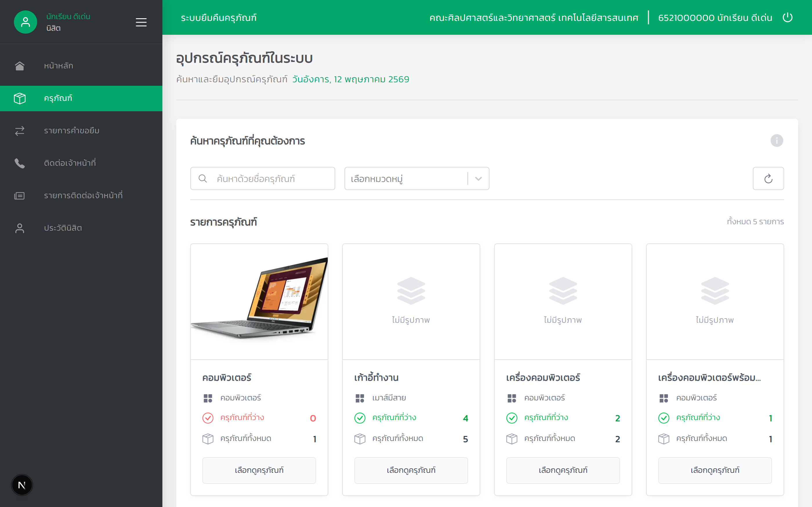
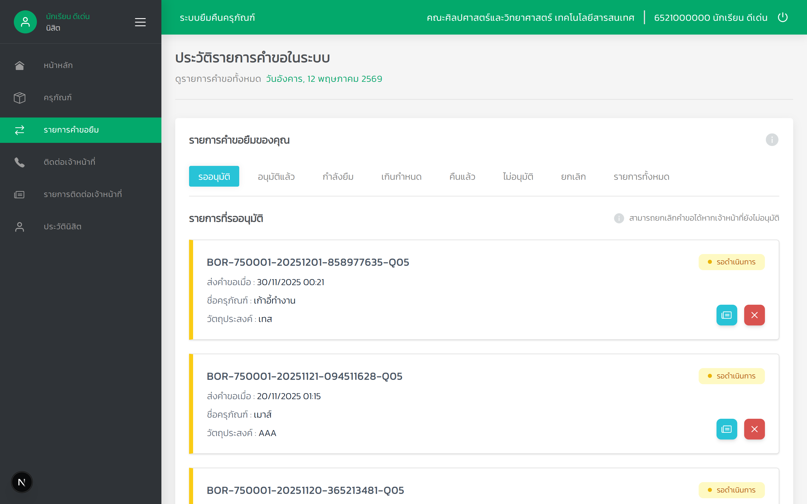

# Equipment Borrowing and Repair Frontend

A Thai-language web application for equipment borrowing, returns, repair requests, and installation requests in an educational institution. Students and teachers browse equipment and track requests; staff manage approvals and equipment; administrators manage users and organizational data.

[Portfolio](https://supat-yad.vercel.app/) · [Backend repository](https://github.com/supat9/borrow-return-backend)

## Screenshots

### Equipment catalog



### Borrow requests



## Features

| Area | Capabilities |
| --- | --- |
| Equipment | Search, category filters, availability, item details, QR labels, and bulk CSV import |
| Borrowing | Submit requests and track pending, approved, active, overdue, returned, rejected, and cancelled states |
| Repair and maintenance | Submit repair requests, select urgency, attach images, scan equipment QR codes, and track progress |
| Installation | Submit and manage installation requests alongside other staff requests |
| Staff dashboard | Equipment status charts, borrowing statistics, and pending actions |
| Administration | User management, faculties and majors, and activity logs |
| Locations | Manage buildings, floors, rooms, and room types |
| Reporting | Export equipment, borrowing, maintenance, installation, and user records through the backend API |
| Authentication | Login, password reset, session-cookie handoff, and role-specific navigation |

## Technology

| Layer | Stack |
| --- | --- |
| Framework | Next.js 16 App Router, React 19 |
| Language | JavaScript and JSX |
| Styling | Tailwind CSS 4, custom components, Ant Design, Headless UI, and Radix UI |
| API integration | Axios and Next.js route handlers |
| Charts | Recharts |
| Forms and feedback | React Hook Form, React Select, and SweetAlert2 |
| Import and labels | Papa Parse, QR codes, jsPDF, html-to-image, and JSZip |
| Companion backend | Node.js, Express, MySQL-compatible database, and Swagger |

## Architecture

The browser calls same-origin `/api` routes in Next.js. These route handlers forward requests and session tokens to the companion Express API. API URLs are configured on the server through environment variables; the browser does not need database credentials.

Role-based redirects in the frontend guide navigation. The backend remains responsible for validating tokens and enforcing access to data.

## Local development

### Requirements

- Node.js 22 LTS and npm
- A running [companion backend](https://github.com/supat9/borrow-return-backend), with its database and test accounts configured

### Install and configure

```bash
git clone https://github.com/supat9/equipment-borrow-repair-frontend.git
cd equipment-borrow-repair-frontend
npm ci
cp .env.example .env.local
npm run dev
```

On PowerShell, use `Copy-Item .env.example .env.local` for the copy step.

Open [localhost:3000](http://localhost:3000). The root page redirects to `/login` until a session is available.

The environment template contains localhost examples for the server-side API endpoints. Start the backend on port 3001, or update the URLs in `.env.local` to match your backend. Use accounts from your own development database; this repository does not include working login credentials.

### Commands

```bash
npm run dev      # Development server
npm run build    # Production build
npm run start    # Production server after building
npm run lint     # ESLint review
```

The GitHub Actions workflow installs dependencies and checks the production build on pushes and pull requests. It does not run backend integration tests.

## Project structure

```text
src/
  app/
    (auth)/          Login and password-reset pages
    admin/           Administration pages
    staff/           Equipment, requests, dashboards, and reports
    users/           Equipment browsing and user requests
    api/             Server-side proxy routes to the Express API
  components/        Shared and role-specific interfaces
  context/           User and staff context providers
  mock/              Example fixtures for development
  middleware.js      Role-based navigation redirects
docs/screenshots/    Application previews
.env.example         Localhost API endpoint template
```

The mock fixtures are examples, rather than a complete offline demo. Borrowing, approvals, exports, and account operations require the companion backend.
